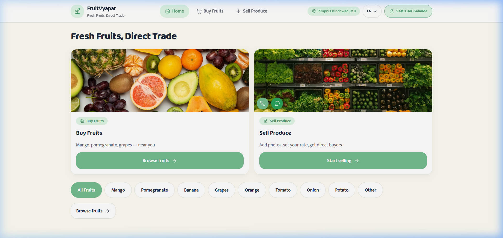
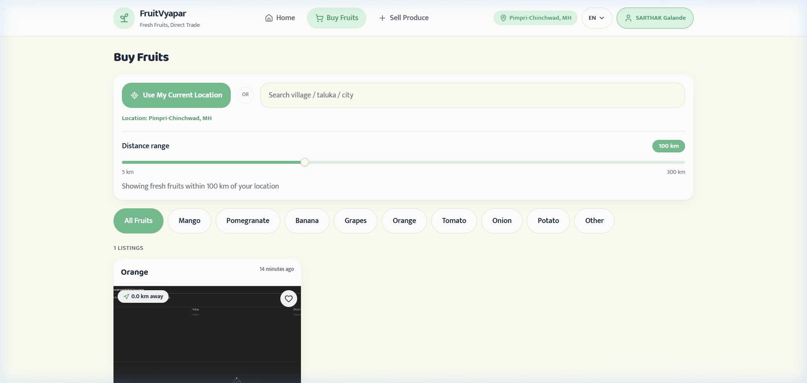
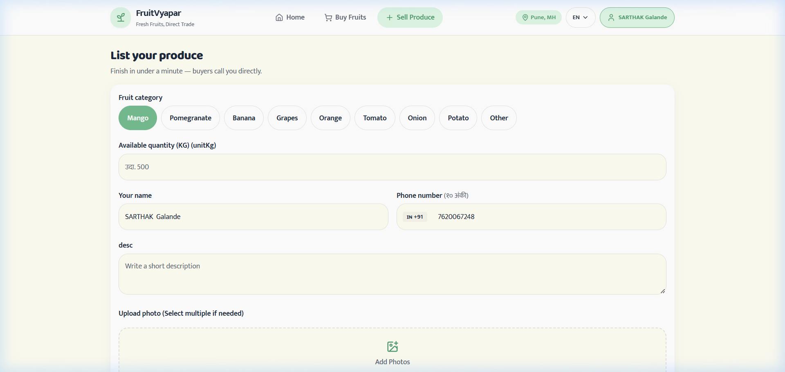
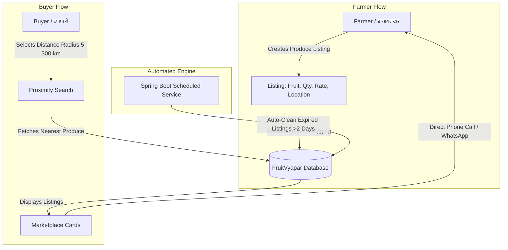

# 🍇 FruitVyapar (फ्रूट व्यापार) — Direct Farm-to-Buyer Fruit Marketplace

> **Empowering fruit farmers across India with direct trade, proximity-based buyer matching, and zero middlemen exploitation.**

[](https://spring.io/projects/spring-boot)
[](https://react.dev/)
[](https://tanstack.com/)
[](https://tailwindcss.com/)
[](https://capacitorjs.com/)
[](LICENSE)

---

## 📌 Problem Statement: The Reality of Fruit Trading

In traditional Indian agriculture and fruit commerce:

1. **Predatory Middlemen (दलाल / Commision Agents):**
   * Between 3 to 5 layers of intermediaries stand between the fruit grower and the end consumer or commercial buyer.
   * Middlemen siphon off **40% to 60%** of the retail value, leaving farmers with meager profits despite taking 100% of the harvest risk.
2. **Information Blindspots & Arbitrary Pricing:**
   * Smallholder farmers lack real-time market data regarding nearby wholesale demand.
   * Farmers are forced to accept whatever rate is dictated at the local APMC mandi.
3. **High Perishability & Severe Food Wastage:**
   * Unlike grains, fruits (mangoes, grapes, bananas, pomegranates, citrus) have a critical shelf life of just 3 to 7 days post-harvest.
   * Logistical delays in finding distant buyers lead to massive post-harvest spoilage and distress sales at loss-making rates.
4. **Wasted Days & Massive Fuel Consumption for Traders & Fruit Vendors (दिवसभर भटकंती आणि इंधनाचा भुर्दंड):**
   * Small fruit vendors, local weekly bazaar traders, and fruit shop owners spend **an entire day** physically traveling between distant villages, farms, and orchards on motorcycles, tempos, or buses just hunting for who has harvest-ready fruit for tomorrow's morning market.
   * **Severe Fuel & Time Losses:**
     * **High Petrol/Fuel Burn:** Driving 50 km to 100+ km without any confirmation of fruit availability burns a significant portion of daily profits on fuel.
     * **Lost Business Day:** An entire working day is lost in transit and searching rather than selling and generating income.
     * **Supply Uncertainty & Empty Trips:** Vendors often reach distant orchards only to find produce already sold, underripe, or overpriced.
5. **Digital & Language Barriers:**
   * Most rural producers cannot navigate complicated English-only e-commerce apps or complex registration workflows.

---

## 🌍 Real-World Impact

FruitVyapar was engineered specifically to solve these fundamental bottlenecks:

* **📈 25% – 35% Higher Farmer Revenue:** Direct trade connects farmers with bulk buyers, retailers, and consumers with zero commission fees.
* **⏱️ Saves 1 Full Day & Eliminates Fuel Wastage for Traders:** Local vendors and fruit sellers no longer have to burn expensive petrol roaming between villages for hours. In seconds, they see who has fruits ready, confirm details over phone/WhatsApp, and make a single targeted pickup.
* **📅 Just-In-Time Daily Sourcing for Tomorrow's Market:** Fruit vendors can plan their inventory for tomorrow's morning market from their home the evening before, ensuring fresh, daily-picked fruit with zero guesswork.
* **🚚 Hyper-Local Discovery (5 km – 300 km):** Distance-based radius matching finds buyers within hours of harvesting, preventing transit spoilage.
* **🗣️ Vernacular Inclusivity:** Native, single-click language toggle across **मराठी (Marathi)**, **हिंदी (Hindi)**, and **English**.
* **📞 Instant Direct Trade:** Single-tap WhatsApp and phone call buttons connect buyers directly with farmers without intermediaries holding transactions hostage.
* **⚡ Frictionless Onboarding:** 6-digit OTP verification ensures security without requiring farmers to remember complex passwords.

---

## 📸 Application Previews

### 1. Home Dashboard
*Clean, bilingual homepage with direct quick-action cards for buying and selling farm produce.*


---

### 2. Proximity-Based Marketplace & Radius Slider
*Interactive distance slider (5 km to 300 km) with geolocation detection and categorized fruit filters.*


---

### 3. Direct Farmer Produce Listing
*Intuitive listing workflow enabling farmers to specify rates, quantity, farm location, and upload produce imagery.*


---

### 4. OTP-Based Secure Authentication
*Lightweight, passwordless 6-digit OTP email & mobile authentication with transparent fair-trade terms.*


---

## 🚀 How It Works



### 1. For Fruit Farmers (विक्रेता / बागायतदार):
1. **Login with 1-Click OTP**: No passwords required.
2. **List Your Harvest**: Select fruit category (Alphonso Mango, Grapes, Banana, Pomegranate, etc.), specify available quantity, expected rate per kg/box, and harvest date.
3. **Set Farm Location**: Auto-detects GPS coordinates or allows manual town/district selection.
4. **Receive Direct Enquiries**: Buyers contact you directly on your verified mobile or WhatsApp.

### 2. For Fruit Buyers & Traders (खरेदीदार / व्यापारी):
1. **Set Search Distance**: Move the interactive radius slider (from 5 km up to 300 km) to find fresh fruit in your vicinity.
2. **Filter by Category**: Instantly browse specific fruit varieties or view all nearby farm listings.
3. **Inspect Details**: View farm location, distance in km, seller name, and verified rate.
4. **Make Direct Deal**: Call the farmer or launch a WhatsApp chat in a single tap to negotiate and arrange pick-up.

---

## 🛠️ Technology Stack & Architecture

### Frontend
* **Framework:** React 19 + TanStack Start & TanStack Router
* **Styling & Design System:** Tailwind CSS v4, OKLCH color palettes, custom responsive typography
* **Icons & Components:** Lucide React, Radix UI primitives, Sonner toasts
* **Maps & Geocoding:** Leaflet, OpenStreetMap Nominatim reverse-geocoding API

### Backend
* **Runtime & Framework:** Java 21, Spring Boot 3.2.3
* **Database & Persistence:** Spring Data JPA, Hibernate ORM, SQLite / H2 (configurable to PostgreSQL/MySQL)
* **API Architecture:** RESTful JSON API with CORS configuration
* **Security & Auth:** In-memory OTP generation engine with rate limiting and automated session tracking
* **Scheduled Services:** Background cleanup cron jobs removing stale fruit listings older than 48 hours

### Mobile
* **Mobile Runtime:** Capacitor 8 (ready for Android APK build)

---

## 💻 Local Setup & Development

### Prerequisites
* **Node.js**: v18+ or v20+
* **Java Development Kit (JDK)**: Java 21+
* **Maven**: 3.9+ (bundled distribution included in `backend/maven_dist`)

### Step-by-Step Installation

1. **Clone the repository:**
   ```bash
   git clone https://github.com/Sarthak8599/Fruitvyapar.git
   cd Fruitvyapar
   ```

2. **Install frontend dependencies:**
   ```bash
   npm install
   ```

3. **Run Frontend & Backend concurrently:**
   ```bash
   npm run dev
   ```
   * **Frontend Server:** Runs on `http://localhost:8080`
   * **Backend API Server:** Runs on `http://localhost:8090`

4. **Run services individually (optional):**
   * **Frontend only:**
     ```bash
     npm run dev:frontend
     ```
   * **Backend only:**
     ```bash
     npm run backend
     ```

---

## 📜 Fair Trade & Platform Governance

FruitVyapar enforces a transparent **9-Point Code of Conduct** for all participants:
* Strict prohibition of misleading rates, fake photos, or intermediary speculation.
* Mandatory genuine harvest details (quantity, price, location).
* Complete protection of farmer contact details and buyer credentials.
* Automated expiry mechanism ensuring no ghost or stale listings remain on the board.

---

## 🤝 Contributing

Contributions, issues, and feature requests are welcome!
Feel free to check the [issues page](https://github.com/Sarthak8599/Fruitvyapar/issues).

---

## 📄 License

This project is licensed under the [MIT License](LICENSE).
